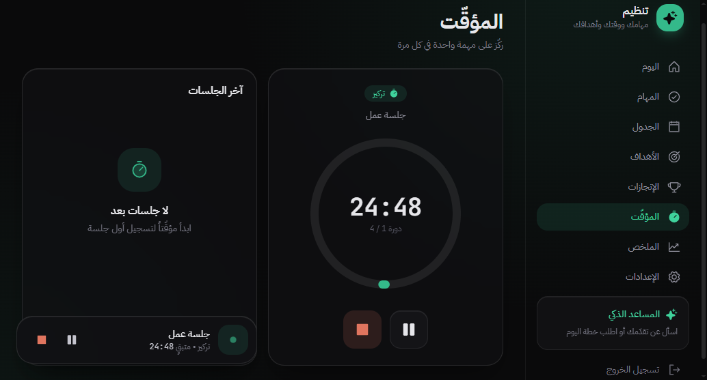
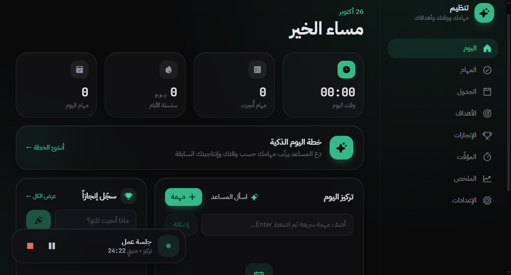
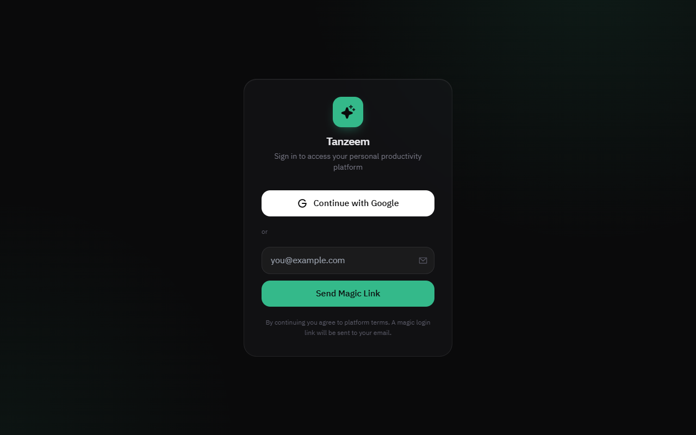
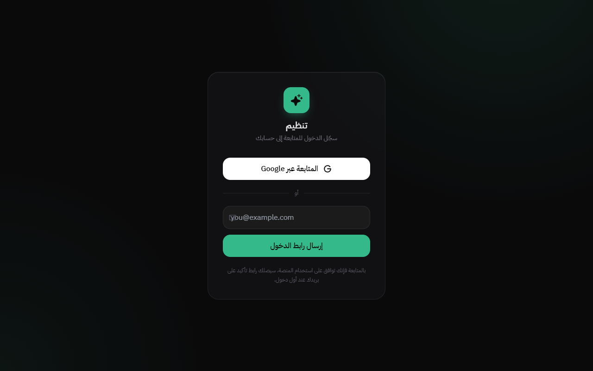
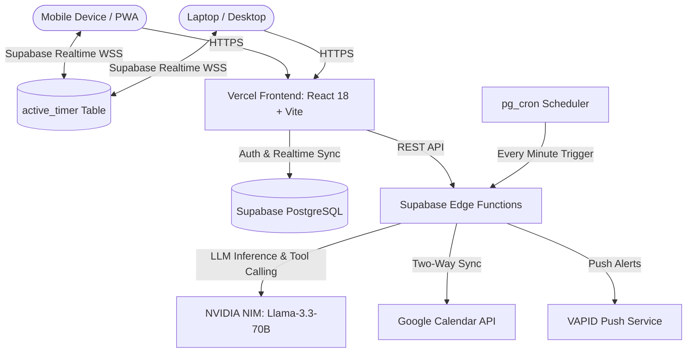

# Tanzeem (تنظيم) — AI-Powered Personal Productivity Hub

<p align="center">
  <a href="https://tanzeem-platform.vercel.app" target="_blank">
    
  </a>
  
  
  
  
  
</p>

<p align="center">
  A modern, high-performance Progressive Web Application (PWA) built for deep work, task execution, schedule management, and goal tracking. Featuring a sleek dark glassmorphism design, real-time cross-device synchronization, and an intelligent AI co-pilot.
</p>

---

## 🌐 Live Application

- **Production URL:** [https://tanzeem-platform.vercel.app](https://tanzeem-platform.vercel.app)
- **Deployment Platform:** Vercel
- **Cloud Infrastructure:** Supabase (PostgreSQL, Realtime, Edge Functions, pg_cron)

---

## 📸 Inside the Application

<p align="center">
  
  
</p>

<p align="center">
  
  
</p>

---

## ⏱️ Deep Dive: The Standout Real-Time & Persistent Timer Engine

The timer in **Tanzeem** is not a simple JavaScript `setInterval` counter. It is engineered from the ground up as a cloud-synchronized, background-resilient focus engine:

### 1. 🔄 True Cross-Device Real-Time Synchronization
- **Single Source of Truth:** A dedicated, user-scoped `active_timer` row in Supabase serves as the single source of truth.
- **Start on Mobile, Control on Laptop:** When you start a Pomodoro block on your smartphone, the exact same live timer instantly begins ticking on your desktop or tablet via Supabase Realtime channels (`supabase.channel`).
- **Unified Controls:** Pausing, resuming, or stopping the timer on any device immediately reflects across all active screens with zero latency, preventing desync or accidental duplicate sessions.

### 2. ⚡ Completely Independent of App / Browser Lifecycle
- **Never Loses Progress:** You can safely close the browser tab, lock your phone, or switch applications. The timer keeps running seamlessly.
- **Timestamp-Based Calculation:** Elapsed time is computed mathematically from absolute epoch timestamps (`segment_start`), rather than relying on an active client tick process. When you reopen the app, the exact remaining focus or break duration is instantly recalculated.

### 3. 🛡️ Conflict-Free Auto-Transitions
- When a Pomodoro focus block elapses while multiple devices are open simultaneously, an atomic **compare-and-swap** lock operates on `phase_started_at`. Only one device wins the execution right to record the completed focus session in the database and advance to the break phase, eliminating duplicate history records.

### 4. 🧭 Global Persistent Floating Bar
- A sleek floating status bar (`RunningBar`) remains active at the bottom of the screen across all pages (`/tasks`, `/schedule`, `/goals`, `/summary`). You can navigate your entire workspace while monitoring remaining time and toggling pause/stop controls at a glance.

---

## ✨ Other Key Features

- **🎯 Task & Execution Engine:** Organize daily tasks by priority, tags, and due dates with instant real-time synchronization across devices.
- **📅 Daily Schedule & Calendar Sync:** Visual timeline planner featuring bidirectional integration with Google Calendar.
- **🏆 Goals & Achievements:** Goal tracking with milestone breakdowns and a gamified productivity rewards system.
- **🤖 Anti-Hallucination AI Co-Pilot:** Powered by `meta/llama-3.3-70b-instruct` on NVIDIA NIM, capable of generating balanced daily schedules, analyzing priorities, and safely invoking task operations with confirmation gates.
- **🔔 Web Push Reminders:** Automated reminders powered by Supabase `pg_cron` and VAPID web push notifications.
- **📱 PWA & Offline Support:** Installable on iOS (Safari Add to Home Screen) and Android / Desktop with full service-worker caching.

---

## 🏗️ System Architecture



---

## 🛠️ Tech Stack

| Layer | Technology |
|---|---|
| **Frontend Framework** | React 18, TypeScript, Vite |
| **Styling & UI** | Tailwind CSS, Framer Motion, Radix UI, Phosphor Icons |
| **Database & Auth** | Supabase (PostgreSQL, Row Level Security, Magic Link & Google OAuth) |
| **Realtime Engine** | Supabase Realtime Channels (`postgres_changes`) |
| **Serverless & Jobs** | Supabase Edge Functions (Deno runtime), `pg_cron` |
| **AI / Machine Learning** | NVIDIA NIM API (`meta/llama-3.3-70b-instruct`) with tool-calling |
| **Sync & Push** | Supabase Realtime Channels, Web Push API (VAPID) |
| **Hosting & CI/CD** | Vercel |

---

## 🚀 Getting Started

### Prerequisites
- Node.js (v18 or higher)
- npm or pnpm

### 1. Clone the repository
```bash
git clone https://github.com/Waelkun/tanzeem.git
cd tanzeem
```

### 2. Install dependencies
```bash
npm install
```

### 3. Environment configuration
Copy the example environment configuration:
```bash
cp .env.example .env.local
```

Fill in your client-side Supabase credentials:
```env
VITE_SUPABASE_URL=https://your-project.supabase.co
VITE_SUPABASE_ANON_KEY=your-supabase-anon-key
VITE_VAPID_PUBLIC_KEY=your-vapid-public-key
```

### 4. Run the development server
```bash
npm run dev
```

### 5. Build for production
```bash
npm run build
npm run preview
```

---

## 📄 License

This project is private and maintained by [Waelkun](https://github.com/Waelkun). All rights reserved.
